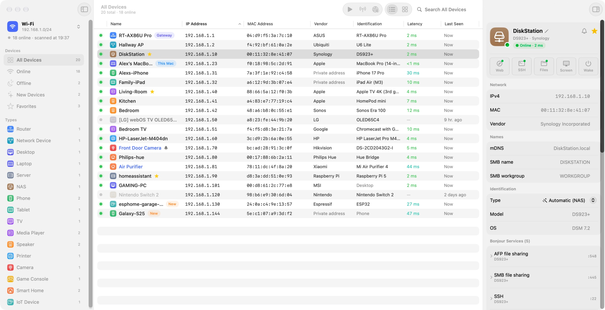
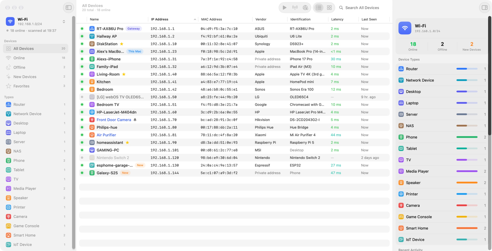
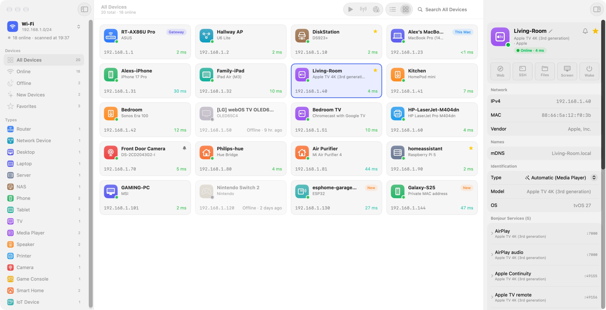

<p align="center">
  
</p>

<h1 align="center">LanDetector</h1>

<p align="center">A native macOS network scanner that finds every device on your LAN and tells you what it is.<br>
macOS 26 Tahoe or later · Apple silicon and Intel · English and Simplified Chinese</p>

<p align="center"><b>English</b> · <a href="README.zh-CN.md">简体中文</a></p>

<picture>
  <source media="(prefers-color-scheme: dark)" srcset="docs/images/en/dark/devices.jpg">
  
</picture>

LanDetector scans a /24 in about four seconds, shows the first devices within a tenth of a second, and keeps a history of every network you scan. It combines ARP, ICMP, mDNS / Bonjour, NetBIOS, reverse DNS, UPnP and port banners to name each device and work out its vendor, model and type – not just its IP and MAC address. Written in Swift 6 and SwiftUI; the only third-party code is [Sparkle](https://sparkle-project.org) for updates, and there is no analytics.

## Features

- **Fast discovery**: ICMP sweep plus ARP, IPv6 neighbor discovery and multicast probes; scan the whole subnet or saved ranges, including ranges behind another router.
- **Identification**: combines Bonjour TXT records, Apple model identifiers, UPnP descriptions, NetBIOS and DNS names, the IEEE vendor registries, open ports and service banners into a device type, model and OS.
- **Device history**: every network keeps its own inventory with first and last seen dates, a 30-day presence timeline and uptime, and is recognized again after a router or MAC address change.
- **Live monitoring**: rescans on a schedule, notifies you about new devices and about devices you watch coming online or going offline, and lives in the menu bar.
- **Network overview**: online, offline and new devices, device types and recent activity at a glance.
- **Port scanning**: fast concurrent TCP scans with IANA service names, web page titles and SSH / FTP greetings.
- **Quick actions**: open a device's web page, SSH, file sharing or Screen Sharing, wake it with Wake on LAN, copy its details.
- **Your own notes**: custom names, notes, URLs, favorites and device types; import and export them.
- **Export**: CSV, TSV, PSV, JSON or Markdown.

<picture>
  <source media="(prefers-color-scheme: dark)" srcset="docs/images/en/dark/overview.jpg">
  
</picture>

<picture>
  <source media="(prefers-color-scheme: dark)" srcset="docs/images/en/dark/cards.jpg">
  
</picture>

## Install

Download the latest `LanDetector-<version>.dmg` from [Releases](https://github.com/lacdonlang/landetector/releases) and drag LanDetector into Applications. On the first scan, allow access to the local network when macOS asks. LanDetector checks for updates once a day and installs them after verifying their signature (LanDetector ▸ Check for Updates… checks right away).

The interface follows your system language. To use a different language for LanDetector only, choose it in System Settings ▸ General ▸ Language & Region ▸ Applications.

> [!NOTE]
> macOS 27 only reveals the MAC addresses in the ARP table to apps signed with a Developer ID, which the releases are. A build you sign yourself in another way scans fine but shows no MAC addresses or vendors.

## Build from source

Requires Xcode 26 or later (developed with Xcode 27 on macOS 27) and [XcodeGen](https://github.com/yonaskolb/XcodeGen).

```bash
Scripts/build.sh --open
```

Or run `xcodegen generate` and open `LanDetector.xcodeproj`; `project.yml` is the source of truth for the project. Signing uses the `Developer ID Application` certificate of `DEVELOPMENT_TEAM` in `project.yml` – change it to your own.

- [Development](docs/en/DEVELOPMENT.md): the command-line tool, tests, debug hooks, screenshots and translations.
- [Releasing](docs/en/RELEASING.md): the tag-triggered release workflow, signing, notarization and updates.
- [Requirements](docs/en/REQUIREMENTS.md) and [plan](docs/en/PLAN.md).

## Data sources

All public or open source:

| Data | Source | License |
|---|---|---|
| MAC vendors | IEEE Registration Authority (MA-L / MA-M / MA-S / IAB / CID) | Public |
| Port service names | IANA Service Name and Transport Protocol Port Number Registry | Public |
| Apple models | [AppleDB](https://appledb.dev) | MIT |

Refresh the built-in data with `python3 Scripts/update_data.py`; the vendor database can also be updated in the app (Settings ▸ Data).
