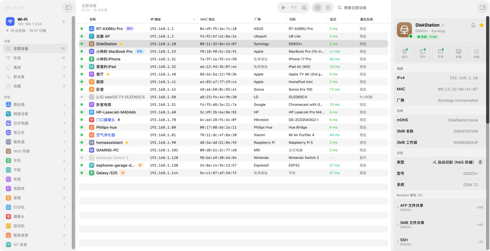
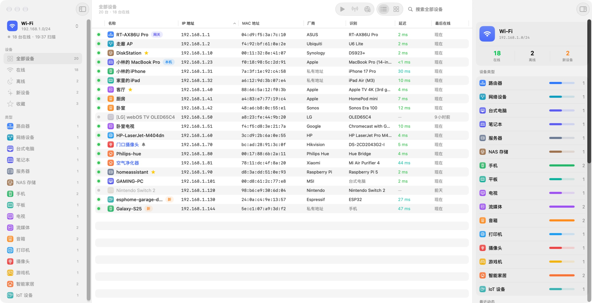
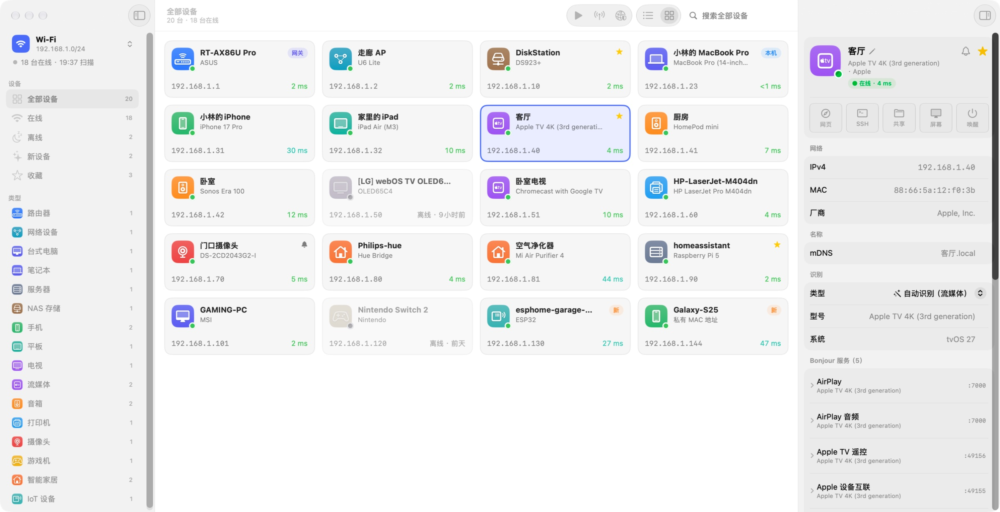

<p align="center">
  
</p>

<h1 align="center">LanDetector</h1>

<p align="center">原生 macOS 局域网扫描器：找出局域网里的每一台设备，并告诉你它是什么。<br>
macOS 26 Tahoe 或更新版本 · Apple 芯片与 Intel · 英文与简体中文</p>

<p align="center"><a href="README.md">English</a> · <b>简体中文</b></p>

<picture>
  <source media="(prefers-color-scheme: dark)" srcset="docs/images/zh-CN/dark/devices.jpg">
  
</picture>

LanDetector 约 4 秒扫完一个 /24 网段，首个结果不到 0.1 秒就出现，并为扫描过的每个网络保留历史。它综合 ARP、ICMP、mDNS / Bonjour、NetBIOS、反向 DNS、UPnP 与端口 Banner，给每台设备起名，并识别厂商、型号与类型，而不只是列出 IP 和 MAC。使用 Swift 6 与 SwiftUI 编写；唯一的第三方代码是用于在线更新的 [Sparkle](https://sparkle-project.org)，没有任何统计。

## 功能

- **快速发现**：ICMP 扫描配合 ARP、IPv6 邻居发现与组播探测；可扫描整个子网或保存的范围，包括另一台路由器后面的网段。
- **设备识别**：综合 Bonjour TXT 记录、Apple 型号标识、UPnP 描述、NetBIOS 与 DNS 名称、IEEE 厂商注册表、开放端口和服务 Banner，判断设备类型、型号与系统。
- **设备历史**：每个网络有自己的设备库，记录首次发现、最后在线、近 30 天的在线时间线与在线率；更换路由器或 MAC 变化后仍能认出同一个网络。
- **实时监控**：定时重新扫描，发现新设备或关注的设备上下线时通知你，可常驻菜单栏。
- **网络概览**：在线、离线与新设备数量，设备类型分布和最近动态一目了然。
- **端口扫描**：高并发 TCP 扫描，显示 IANA 服务名、网页标题与 SSH / FTP 欢迎信息。
- **快捷操作**：打开设备网页，SSH、文件共享或屏幕共享连接，网络唤醒，拷贝设备信息。
- **自定义信息**：自定义名称、备注、网址、收藏与设备类型，可导入导出。
- **导出**：CSV、TSV、PSV、JSON 或 Markdown。

<picture>
  <source media="(prefers-color-scheme: dark)" srcset="docs/images/zh-CN/dark/overview.jpg">
  
</picture>

<picture>
  <source media="(prefers-color-scheme: dark)" srcset="docs/images/zh-CN/dark/cards.jpg">
  
</picture>

## 安装

从 [Releases](https://github.com/lacdonlang/landetector/releases) 下载最新的 `LanDetector-<版本>.dmg`，把 LanDetector 拖进“应用程序”。首次扫描时 macOS 会请求访问本地网络，请允许。LanDetector 每天检查一次更新，校验签名后自动安装（“LanDetector ▸ 检查更新…”可立即检查）。

界面语言跟随系统。只想让 LanDetector 使用另一种语言时，在“系统设置 ▸ 通用 ▸ 语言与地区 ▸ 应用程序”中设置。

> [!NOTE]
> macOS 27 只向 Developer ID 签名的应用开放 ARP 表里的 MAC 地址，正式发布的版本满足这一点。用其他方式自行签名的构建能正常扫描，但看不到 MAC 地址与厂商。

## 从源码构建

需要 Xcode 26 或更新版本（开发于 Xcode 27 / macOS 27）与 [XcodeGen](https://github.com/yonaskolb/XcodeGen)。

```bash
Scripts/build.sh --open
```

也可以运行 `xcodegen generate` 后打开 `LanDetector.xcodeproj`；`project.yml` 是工程的唯一来源。签名使用 `project.yml` 中 `DEVELOPMENT_TEAM` 的 `Developer ID Application` 证书，请换成你自己的。

- [开发](docs/zh-CN/DEVELOPMENT.md)：命令行工具、测试、调试钩子、截图与翻译。
- [发布](docs/zh-CN/RELEASING.md)：按 tag 触发的发布流水线、签名、公证与在线更新。
- [需求清单](docs/zh-CN/REQUIREMENTS.md)与[实施计划](docs/zh-CN/PLAN.md)。

## 数据来源

全部公开或开源：

| 数据 | 来源 | 许可 |
|---|---|---|
| MAC 厂商 | IEEE Registration Authority（MA-L / MA-M / MA-S / IAB / CID） | 公开 |
| 端口服务名 | IANA Service Name and Transport Protocol Port Number Registry | 公开 |
| Apple 型号 | [AppleDB](https://appledb.dev) | MIT |

更新内置数据：`python3 Scripts/update_data.py`；也可在应用的“设置 ▸ 数据”中在线更新厂商库。
